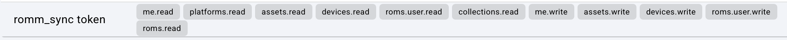

# Configuration Guide

Detailed setup and reference for RomM-Syncthing-Sync. For how sync decisions and edge cases are handled, see [docs/SYNC_STRATEGY.md](docs/SYNC_STRATEGY.md).

## Contents
- [Files](#files)
- [RomM configuration](#romm-configuration)
- [Sync folder layouts](#sync-folder-layouts)
  - [Single sync folder](#single-sync-folder)
  - [Separate save and state parents](#separate-save-and-state-parents)
  - [Sorting by core and content directory](#sorting-by-core-and-content-directory)
- [Sync mode](#sync-mode)
- [Optional variables](#optional-variables)
- [Platform mapping](#platform-mapping)
- [Web UI](#web-ui)
- [History database](#history-database)
- [Possible incompatibilities](#possible-incompatibilities)
- [Known issues](#known-issues)

## Files
Download `docker-compose.yml`, `.env.example`, and `platform_mapping.yaml` (if desired) to the directory of your choice. Typically, you would rename `.env.example` to `.env` and update the corresponding line in `docker-compose.yml` accordingly (`env_file: .env`).

`docker-compose.yml` is written such that you should not need to edit it at all. Instead, all variables are configured in `.env`. The compose file bind-mounts `${PLATFORM_MAP_FILE}`, so keep that variable set (or remove the line from the compose file if you don't use a mapping).

I didn't account for every possible use case; generally, this will work best if you have saves and states synced and sorted by platform with a single RomM user. To experiment safely, e.g. with multiple instances syncing save data for several RomM users at once, mount the sync folders read-only (`:ro`) or set `PUSH_ONLY=true`.

## RomM configuration

**`ROMM_URL`:** (required)
Your RomM instance's address. I generally recommend using a reverse proxy for this instead of a raw LAN IP address. 

RomM 5.x is required (device sync and `/content` downloads need it).

**`ROMM_AUTH_TYPE`:** (required)
Authentication type for RomM. Options are "http" or "api".

"api" is recommended so that publicly hosted RomM instances can be locked behind OIDC only. If the variable is unset the app falls back to "http"; `.env.example` sets it to "api".

**`ROMM_API_TOKEN`**: (recommended; required for api auth)

Your API token for RomM. This is required when `ROMM_AUTH_TYPE`=api.

You can get a token by clicking on your profile image in your RomM webUI (top right on the refreshed UI) --> "Client API Tokens" --> Create. Even though `romm_syncthing_sync` doesn't actually have any code that can delete your library, I recommend limiting the permissions just to be safe. These are the permissions I use. They don't allow writing to the actual rom library, collections, or users.



**`ROMM_USERNAME`**:
Your username in RomM. Required for http auth, not needed for API auth.

**`ROMM_PASSWORD`**:
Your password for RomM. Required for http auth, leave empty if using API auth.

**`ROMM_API_LIMIT`**: (optional)
Pagination limit for pulling the full list of ROM's down from RomM. Default follows RomM's default (50 items / request). If you have a very large library, you could try increasing this to speed up initial library build, but you may run into API issues. Changing this is generally not needed; most of the library build is spent getting each save and state catalogued.

**`ROMM_PUBLIC_URL`**: (optional)
Address your browser uses for the Web UI's "Open RomM" link. Defaults to `ROMM_URL`. If you are using a reverse proxy address, you do not need to set this. If your `ROMM_URL` is an internal docker network address, you *will* need to set this if you want the webui link to work.

## Sync folder layouts
This app allows you to use one of two different folder layouts. Set either `ALL_SYNC_FOLDER` **or** both `SAVE_SYNC_FOLDER` and `STATE_SYNC_FOLDER`; setting all three (or only one of save/state) fails validation at startup.

The compose file mounts the folders into the container at `/syncdata/...`. Do not change those targets.

For the RetroArch settings these layouts depend on, see [Supported Folder Structures](README.md#supported-folder-structures) in the README.

### Single sync folder
This is similar to Knulli's default. All saves and states are sorted by content directory but placed in the same parent folder, organized like:
```
{ALL_SYNC_FOLDER}/
├── Nintendo 64/
│   ├── Game Name.srm
│   ├── Game Name.state
│   └── Game Name.state.png
└── Game Boy Advance/
    ├── Another Game.srm
    └── Another Game.state
```
For this type of sync, use ONLY:

**ALL_SYNC_FOLDER**: the directory on your machine

### Separate save and state parents
This is the way I do it because CFW's like MuOS and MinUI/NextUI put their saves and states in completely different places, but still sort by content directory. On Android, you would set your save and state save locations to be different but retain the "Sort by Content Directory" (ONLY!) setting.
```
{SAVE_SYNC_FOLDER}/
├── Nintendo 64/
│   ├── Game Name.srm
└── Game Boy Advance/
    ├── Another Game.srm
{STATE_SYNC_FOLDER}/
├── Nintendo 64/
│   ├── Game Name.state
│   └── Game Name.state.png
└── Game Boy Advance/
    └── Another Game.state
```
For this, use:

**SAVE_SYNC_FOLDER**: local directory with save files (.srm)

**STATE_SYNC_FOLDER**: local directory with state files (.state etc.)

### Sorting by core and content directory
If you also sort your saves and/or states by core (**in addition to "by content directory"**), the core folder goes inside the content directory. This is supported in either layout and can be mixed with files not organized by core.
```
{SYNC_FOLDER}/
└── Game Boy Advance/
    ├── Another Game.srm            (flat)
    └── mGBA/
        ├── Game Name.srm
        ├── Game Name.state
        └── Game Name.state.png
```

Enabling **Sort Saves/States by Core** is recommended: it keeps files organized and makes syncing with RomM's web player more seamless, since files in a core folder are sent to RomM with that core as their emulator. It is also generally easier to sync with different CFW's using this setting.

(This was added in `1.6.0` to try and mitigate the quagmire of syncthing folder-fu needed for CFW's that are irritatingly opinionated on how they layout saves and states *cough* muos pickles *cough*.)

## Sync mode

**`SYNC_MODE`** (default `watch`)
- "watch" (default): Runs a full sync when starting the container, then incremental afterward based on changes to files in the sync folders.
- "periodic": runs the full sync between your local library and RomM library every `SYNC_INTERVAL_SECONDS`.
   - Simpler but if you have a large library, syncs may take a while because it queries the RomM API for every single save and state you have.
   - I have about 40 different games synced with 1 save and a couple states each, running on the same machine as the instance, and a full sync with no changes takes ~20 seconds.

The default is the incremental sync. I generally recommend using the incremental sync and don't thoroughly test the periodic. I may remove the periodic option entirely at a later date.

## Optional variables
- `WATCHDOG_DELAY_SECONDS` (`watch` mode only)
    - the amount of time to wait for a period of no file system activity once a change is detected.
    - DEFAULT: 60s (`.env.example` sets 30s). With 60s, if you save a state at t=0s, syncthing grabs it and puts it on the server at t=5s, and then you save a state again at t=45s (which syncthing again pushes 5s later), the server will not attempt to sync until t=110s.
- `SYNC_INTERVAL_SECONDS` (`periodic` mode only)
    - sync interval for the full sync. A full sync can take a while, especially for larger libraries. Default = 1800s (30 minutes).
- `FULL_INITIAL_SYNC` (both)
    - Exposed in v1.1.0 and changed to default `True`. This enables a full initial sync to RomM on app startup. Previously, the incremental sync would only push files when it saw changes, which could lead to unexpectedly missing files.
    - Options: `True`, `False`, `Force`. Force is the same behavior as `FORCE_PUSH_SYNC`, but only does it on app startup.
- `FORCE_PUSH_SYNC` (both)
    - Push all changed save files and states to RomM regardless if RomM's state is newer. This is a little dangerous. Defaults to `False`.
- `PULL_INTERVAL_SECONDS` (`watch` mode only)
    - How often RomM is checked for changes made on its side (another device, the web player). Default = 1800s. In `periodic` mode this check runs at the start of each full sync. Skipped when the app is push-only (see [Web UI](#web-ui)).
- `LOG_DB_RETENTION_DAYS` (both)
    - How many days of sync history are kept (see [History database](#history-database)). Default = 90; must be a positive number. The newest sync record of every file is always kept, because change detection depends on it.
- `PLATFORM_MAP_FILE`
    - Path to the platform mapping file on the host (see [Platform mapping](#platform-mapping)). It is mounted at `/config/platform_mapping.yaml`.
- `DATA_DIR`
    - Host folder for the history database and conflict backups, mounted at `/data`. The compose file defaults it to `./romm_sync_data`.
- `WEBUI_PORT`
    - Port for the Web UI. Default = 8080.
- `PUSH_ONLY`
    - Default `false`. Forces push-only mode; also turned on automatically when a sync folder is mounted read-only. See [Web UI](#web-ui).
- `SYNCTHING_URL`, `SYNCTHING_API_KEY`
    - Optional. Show which device last changed a file in the Web UI (see [Web UI](#web-ui)).
- `LOG_LEVEL`
    - `DEBUG`, `INFO` (default), `WARNING`, `ERROR`, `CRITICAL`. `DEBUG` is very verbose and includes all API calls and file operations. `TRACE` is also accepted.
- `TZ`
    - Timezone for log timestamps only. Default is UTC.

## Platform mapping
A .yaml file is included that you can edit to map your platform directories (i.e snes, nds,...) to the platform "slug" that RomM expects. The app forces a match by game platform, similar to how RomM's uploads work, so this mapping file is required if the platform folder names in your library are different from RomM's. By default, this list attempts to cover for some common systems and alternative slugs used in MinUI/NextUI and Knulli, but it is NOT exhaustive so keep an eye on the logs if you're not seeing some games show up.

See https://docs.romm.app/latest/Platforms-and-Players/Supported-Platforms/ for RomM's supported platforms.

The mapping is not required, but if it isn't provided (or the file is not found), the app can only match *exactly* to RomM's slug.

A tip that really helped me is that RomM allows you to map your *local* directory names to *their supported platform names* ("slugs") to make library management easier. [See the docs here.](https://docs.romm.app/latest/Getting-Started/Configuration-File/?h=platform+name#custom-folder-names)

## Web UI

Open `http://<host>:8080` (`WEBUI_PORT`). It shows the last sync, files that changed on both sides ("Needs you"), both libraries, and a per-game history. Resolving a conflict uploads the sync-folder copy to RomM or overwrites the sync-folder copy with RomM's; the losing copy is saved in `DATA_DIR/backups` first. A screenshot tour is in [WEBUI.md](docs/WEBUI.md).

- **Push-only vs two-way.** Sync folders mounted `:ro` (or `PUSH_ONLY=true`) keep the app push-only: it pushes local files to RomM exactly as before, never writes to the sync folders, and "Keep RomM copy" is disabled. Drop `:ro` to also pull RomM-side changes into the sync folders, and to download saves and states that exist only in RomM (for example from RomM's web player). A download never overwrites an existing file: if its path is taken by a different save, or the matching core folder doesn't exist, it is listed in "Needs you" instead.
- **History.** `DATA_DIR/romm_sync.db` (SQLite) records every push, pull and resolution. A conflict means the file changed locally and in RomM since the last recorded sync; a file that exists on both sides with no history is baselined silently when the contents match, and otherwise held in "Needs you" as "Differs, no sync history" for a one-time pick (push-only mode still uses modified time, as before).
- **Device names.** Set `SYNCTHING_URL` and `SYNCTHING_API_KEY` to show which device last changed a file (GET requests only). Syncthing `*.sync-conflict-*` files appear in "Needs you".
- The UI has no login. Keep it on your LAN or behind your reverse proxy's auth.

## History database
The app keeps a SQLite database in `/data` (keep that volume, or history and change tracking reset when the container is recreated). It records every push, pull, conflict, resolution and failed transfer, which is what lets the app tell "changed here", "changed on RomM" and "changed on both" apart without trusting clocks. Old history is pruned after `LOG_DB_RETENTION_DAYS`. See [docs/SYNC_DB.md](docs/SYNC_DB.md) for the tables and details.

## Possible incompatibilities
- Core folder names are matched against the cores RomM's in-browser player (EmulatorJS) supports, plus gpSP. A folder that isn't a recognised core (like `User`) is not treated as one.
- If the same game has a save or state in more than one place (say flat and in a core folder, or under two different cores), only the most recently modified copy is synced to RomM.
- melonDS (standalone) states (`.ml1`, `.ml2`, ...) are supported alongside RetroArch's `.state` files for sync purposes, but may not work in RomM's browser emulation since that is made for libretro.
- The game files (ROM, with one M) on your device are assumed to be *already* the same files as the ROMs in your RomM library. Set up your RomM library before trying to run this app.

## Known issues
- States are not covered by RomM's device sync (`/api/sync/negotiate`), so state conflicts rely on the local history database and RomM's `updated_at`.
- The Web UI has no login (see [Web UI](#web-ui)).
