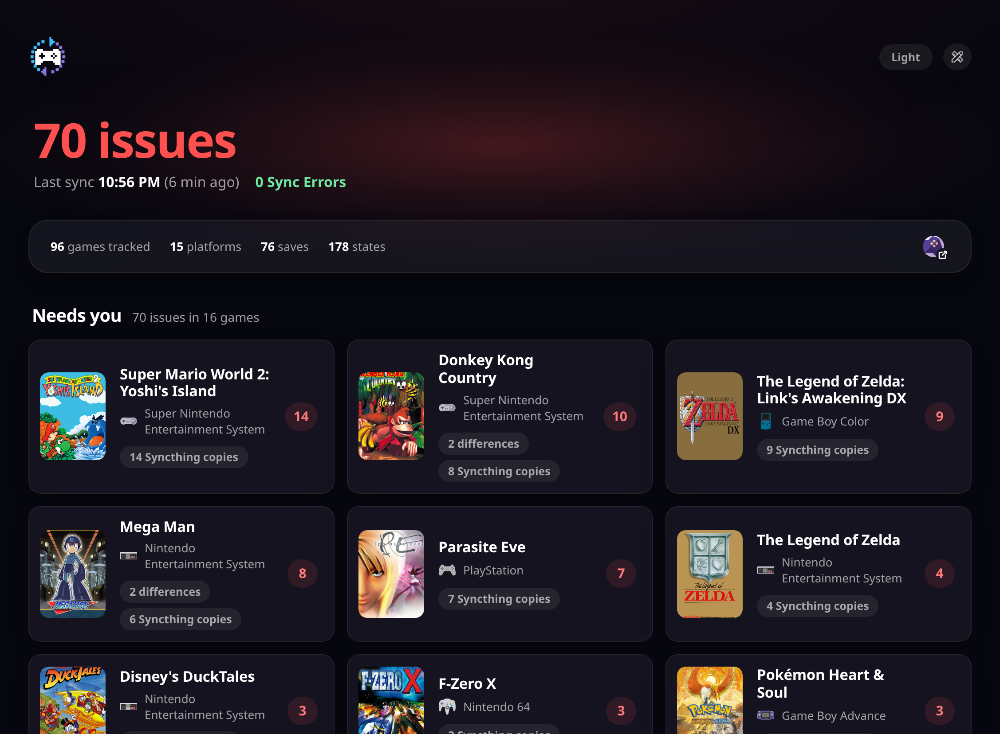
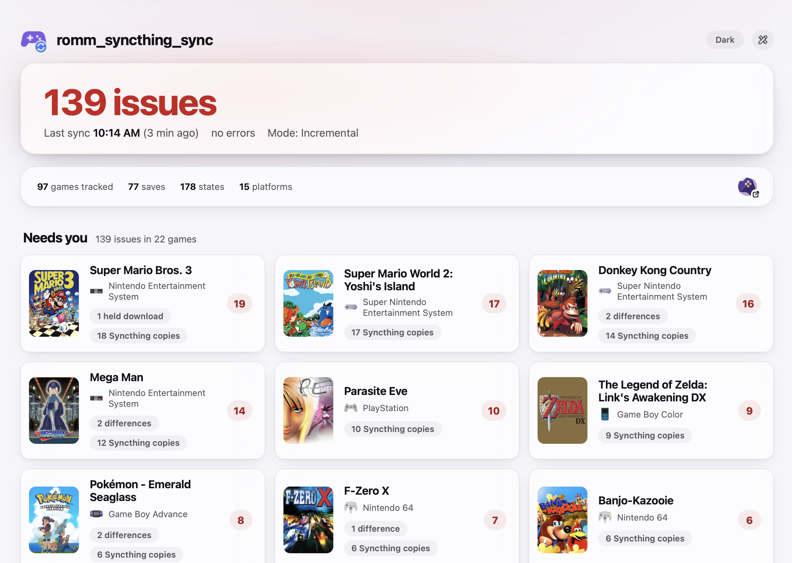
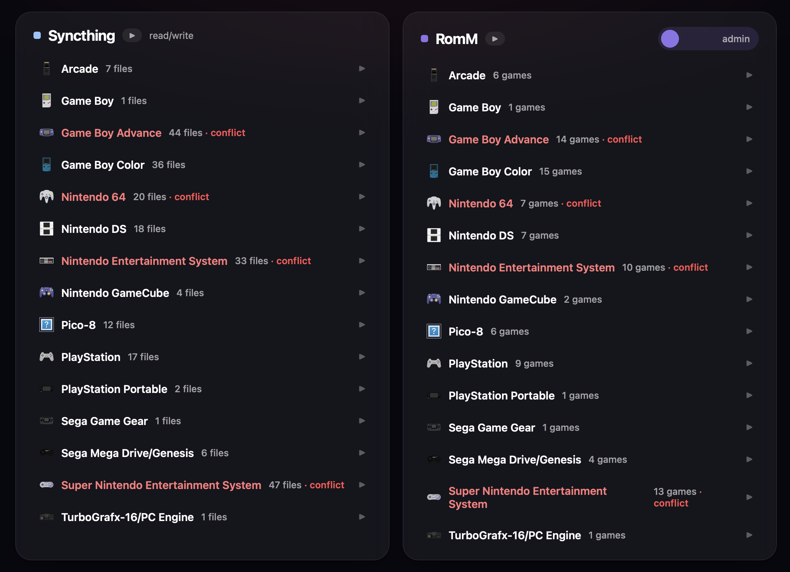
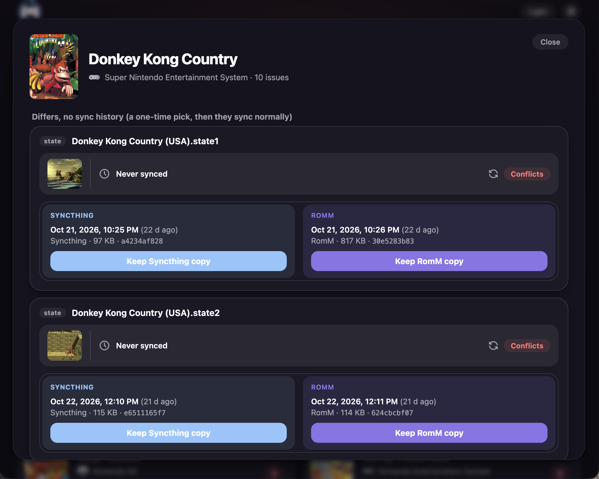
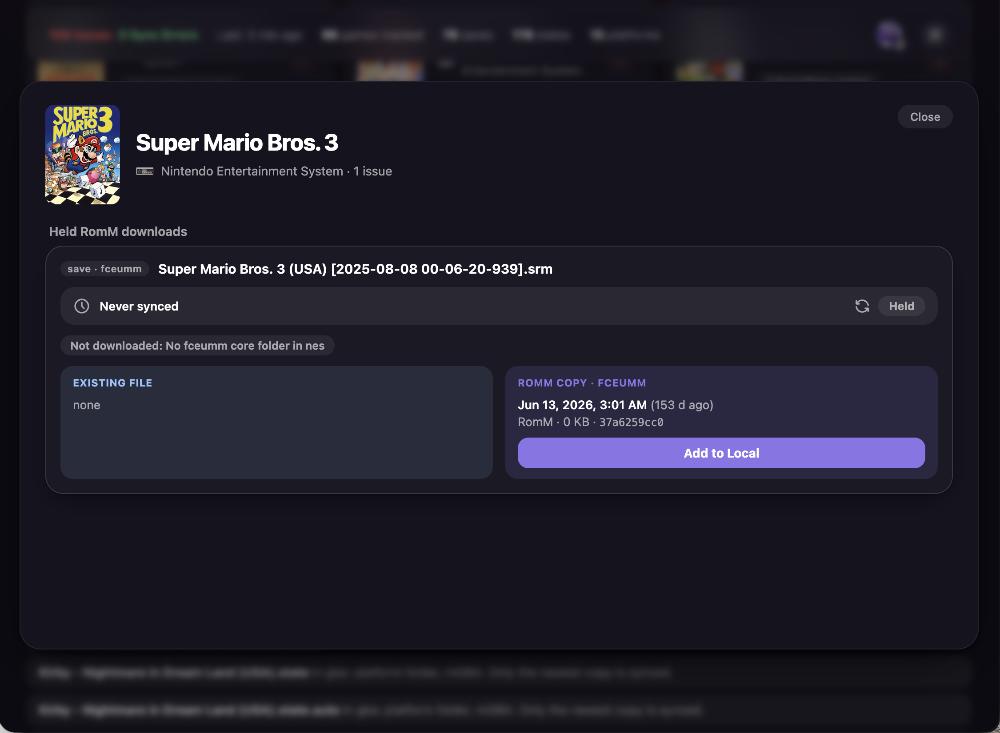
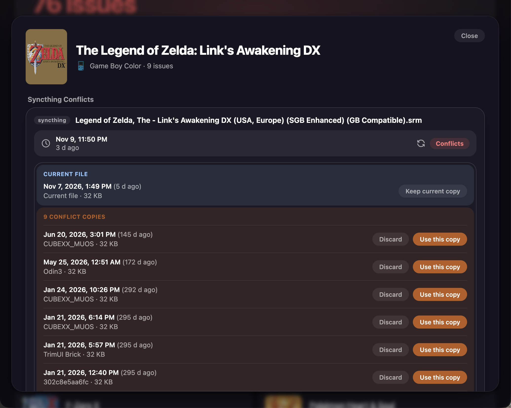

# RomM-Syncthing-Sync


A utility for syncing emulator save files across your gaming devices and backing them up to [RomM](https://romm.app/).

[v2 Update](docs/v2_migration.md) 11/11/2026: pulls from RomM and a WebUI for sync management!

# Overview

I've found that RomM is a nice way to have a "source of truth" for my game library but between the many different frontends available on android and the ever-evolving open source toolset, I wanted self-hosted curation of my gaming content that could work across Syncthing, frontends, linux devices, and any PC running RomM for in-browser emulation. 

If you have multiple handhelds and devices of various form factors whose saves are kept in sync with syncthing and want a way to have those in RomM so you can switch back and forth at will, **romm_sync** might help! 

This all started when I set up Syncthing between my devices with Retroarch-based OS's (Android, MuOS, Knulli,...) and Minarch-based OS's (MinUI, NextUI) and none of the folders lined up properly and forced me into making a tedious Syncthing folder setup. Doable yes, but annoying. I had my RomM instance sitting right there and an opportunity to practice my Python for work so now...here we are.

## What you'll need:
- A server or NAS of some kind that hosts a central file sync. I use and recommend Syncthing.
- A self hosted instance of RomM that is accessible by the machine on which this app is deployed. **RomM 5.x is required** (device sync and `/content` downloads need it).
- Docker to deploy the app.

## What this does:
1. Gaming devices sync save files to a central location via Syncthing.
2. `romm_sync` detects new/modified saves and states in this "local library"
3. Matches the contents of your library with the content on your RomM instance.
4. Pushes new/changed files to RomM and, unless the sync folders are mounted read-only, pulls RomM-side changes (for example web player saves) back into the sync folders. Files changed on both sides are held for you to resolve in the Web UI.

How sync decisions and edge cases are handled: [docs/SYNC_STRATEGY.md](docs/SYNC_STRATEGY.md).

```
Gaming Devices (RetroArch, etc.)
         ↓ (Syncthing)
    Central Sync Folder
         ↕ (romm_sync watches)
    RomM Database (via API)
    + (Optional and Separate) Backup Location
```

## Supported Folder Structures
I wrote this mainly for my uses, so it's probably not taking every possible folder structure into account. It supports two specific flags in Retroarch's `Saving` settings menu.

**"Sort Saves/States by Content Directory"**: Use this when you're not worried about core assignment. This is ok if you are in full control of your Retroarch config. 

If you are sharing with Minarch (MinUI, NextUI) or MuOS (Pickles) or use different cores for a given platform like mGBA and gPSP for Game Boy Advance, you may want to enable **Sort Saves/States by Core**. Enabling it is recommended in general: it keeps files organized and makes syncing with RomM's web player more seamless.

You can mix both, and a single library can have some files flat and some in core folders. Files in a core subfolder within a platform directory ("content directory") are sent to RomM with that core listed as their emulator.

Saves and states can live in one parent folder (`ALL_SYNC_FOLDER`) or in separate parents (`SAVE_SYNC_FOLDER` and `STATE_SYNC_FOLDER`), always sorted by platform folder first, with an optional core folder inside:
```
{SYNC_FOLDER}/
├── Nintendo 64/
│   ├── Game Name.srm
│   ├── Game Name.state
│   └── Game Name.state.png
└── Game Boy Advance/
    ├── Another Game.srm            (flat)
    └── mGBA/                       (sorted by core)
        ├── Game Name.srm
        ├── Game Name.state
        └── Game Name.state.png
```
See the [Configuration Guide](CONFIGURATION_GUIDE.md#sync-folder-layouts) for the single vs separate parent layouts and [possible incompatibilities](CONFIGURATION_GUIDE.md#possible-incompatibilities).

The implicit assumption here is that the game files (ROM, with one M) on your device are *already* the same files as the ROM's in your RomM library. Set up your RomM library before trying to run this app. If your platform folder names differ from RomM's, see [Platform mapping](CONFIGURATION_GUIDE.md#platform-mapping).

# Quickstart
Download `docker-compose.yml`, `.env.example`, and `platform_mapping.yaml` to a directory of your choice. Rename `.env.example` to `.env` and set `env_file: .env` in the compose file (it works as written too). The compose file pulls the latest image and should not need other edits; everything is configured in `.env`.

## Default configuration
By default the app runs in `watch` mode: a full sync at startup, then incremental syncs 60 seconds after file activity stops, plus a check of RomM for changes made on its side every 30 minutes. The Web UI is on port 8080 and the history database lives in `DATA_DIR`.

A minimal `.env`:
```
ROMM_URL=http://RomM-app:8000
ROMM_AUTH_TYPE=api
ROMM_API_TOKEN=your-token

# Either these two...
SAVE_SYNC_FOLDER=/path/to/saves
STATE_SYNC_FOLDER=/path/to/states
# ...or just ALL_SYNC_FOLDER=/path/to/saves-and-states (not both)

PLATFORM_MAP_FILE=./platform_mapping.yaml
DATA_DIR=./romm_sync_data
```
See the [Configuration Guide](CONFIGURATION_GUIDE.md) for [RomM authentication](CONFIGURATION_GUIDE.md#romm-configuration), [sync modes](CONFIGURATION_GUIDE.md#sync-mode), and [all optional variables](CONFIGURATION_GUIDE.md#optional-variables).

## Spin it up!
Run the following from a terminal.
```bash
cd {YOUR_DIRECTORY_OF_CHOICE}
docker compose up -d
```

That oughta be it...now it should just work™ and you should soon see all your saves and states in RomM!

## Web UI
Open `http://<host>:8080`. It shows the last sync, files that changed on both sides ("Needs you"), both libraries, and a per-game history.

<table>
  <tr>
    <th>Dark</th>
    <th>Light</th>
  </tr>
  <tr>
    <td width="50%"></td>
    <td width="50%"></td>
  </tr>
</table>

Below "Needs you", the Syncthing and RomM dashboards list the same games from each side, by platform, with the device that last changed each file. Files with an open issue are highlighted.



### Conflict Resolution Features
Files that differ between the two sides, downloads RomM can't deliver, and Syncthing's own `.sync-conflict` copies can all be settled from the same page.

<table>
  <tr>
    <th>Differences</th>
    <th>Held RomM downloads</th>
    <th>Syncthing conflict copies</th>
  </tr>
  <tr>
    <td width="33%"></td>
    <td width="33%"></td>
    <td width="33%"></td>
  </tr>
</table>

The full walkthrough, including resolving differences and held downloads, is in [docs/WEBUI.md](docs/WEBUI.md). See [Web UI](CONFIGURATION_GUIDE.md#web-ui) for push-only vs two-way mode, conflict resolution, and the [history database](CONFIGURATION_GUIDE.md#history-database).

### Security Notice
As of now, the UI has no login. **Please keep it on your LAN only** and *do not expose the port* unless you know what you're doing and have your own proxy/auth setup. 

### Warning
With a two-way sync, this application now has the potential to *delete your saves*. Backups are always taken, placed in `/data/backup`, and no destructive operations will ever be taken without user intervention, but please do make your own backups and use Syncthing file versioning as cheap insurance. I am not responsible for anything you accidentally delete.

## This is *still* not a full RomM client
It will pull saves to your syncthing-managed library now but from there it's on you. This application is best for those who already have a working syncthing set up and want to link it with RomM or also use their own clients like Grout and Argosy.

# Known Issues
See [Known issues](CONFIGURATION_GUIDE.md#known-issues).
