# Web UI walkthrough

The web UI (`http://<host>:8080`, set by `WEBUI_PORT`) is where romm_sync shows you what it did and asks about what it will not decide on its own. This page walks through it from the top of the page down. For why a file lands in a given state, see [Sync strategy](SYNC_STRATEGY.md); for setup, see the [Configuration guide](../CONFIGURATION_GUIDE.md#web-ui).

There is no login. Keep the port on your LAN or behind a reverse proxy with auth.

## 1. The overview

<table>
  <tr>
    <th>Dark</th>
    <th>Light</th>
  </tr>
  <tr>
    <td width="50%">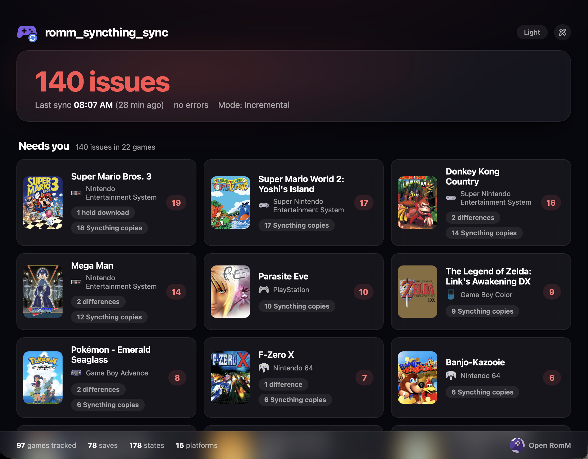</td>
    <td width="50%">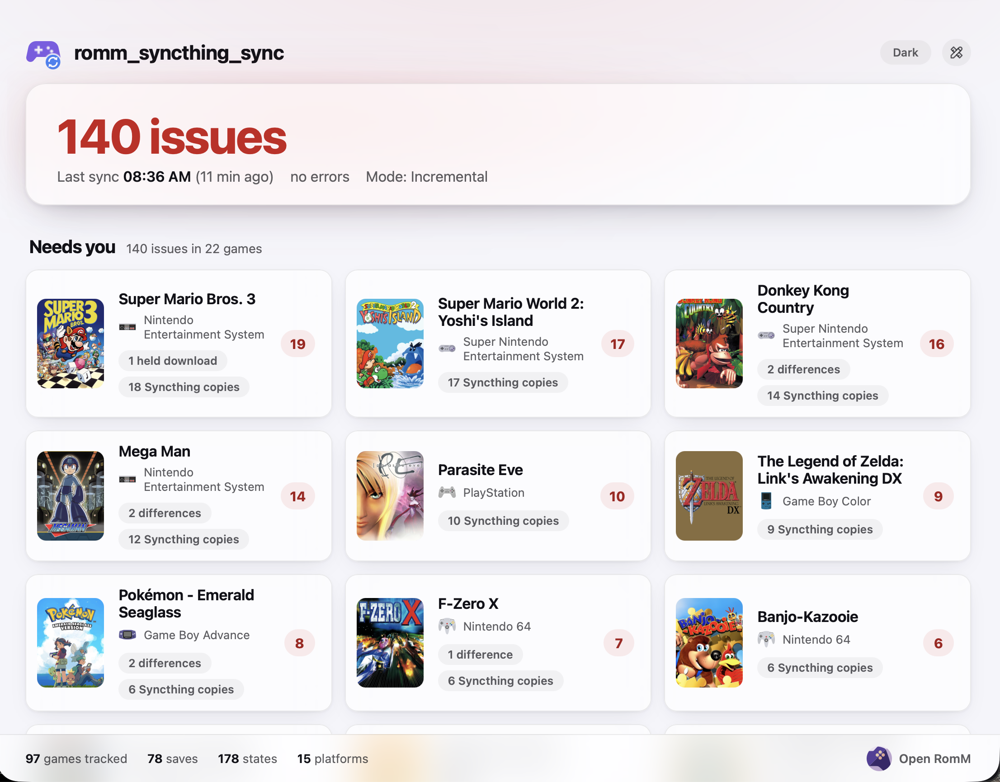</td>
  </tr>
</table>

The toggle in the top right switches between the two themes.

- **Hero card.** The number of open issues, the time of the last sync, whether it had errors, and the sync mode. When there is nothing to resolve it says so instead.
- **Needs you.** One card per game with something open, sorted by the number of conflicts and then by the number of issues. The badge on the right is the total for that game. The chips list what kind of issues it has:
  - *conflict*: changed locally and in RomM since the last sync.
  - *difference*: both sides exist, the content differs, and there is no sync history to say which one is right.
  - *held download*: a file that only exists in RomM and cannot be placed locally.
  - *Syncthing copy*: a `.sync-conflict` copy left by Syncthing.
  - *Not synced: N RomM matches*: the local game name matches several RomM games.
- **Footer.** Library totals (games tracked, saves, states, platforms) and a link that opens RomM.
- **Top right.** The theme toggle and the actions menu: prune backups, rebuild the library (a full sync), and pull changes from RomM. In push-only mode the menu notes that nothing is written to the sync folders and the actions that write are disabled.

Click a card to open that game's issues. Click a file in the dashboards below to see its history.

## 2. The two dashboards

Under "Needs you" the page is split into two columns, one for each side of the sync. Both are organized the same way: platform, then core folder (if you sort by core), then game. A platform with an open issue is highlighted and opens by default.

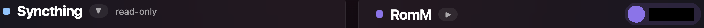

The small arrow next to each panel's title opens or closes every platform group in that panel at once. It shows the current state: a down arrow means everything is open (click to collapse all), a right arrow means at least one group is closed (click to expand all). Your open and closed choices are kept when the page refreshes.

### Syncthing (the sync folders)

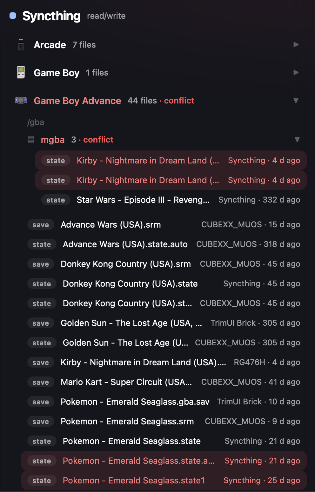

Every save and state romm_sync found in the sync folders, with the device that last changed it (read from Syncthing when `SYNCTHING_URL` and `SYNCTHING_API_KEY` are set, otherwise `Syncthing`) and how long ago. The badge next to the title says whether the folders are `read/write` or `read-only` (push-only). Files with an open issue are shaded red.

### RomM

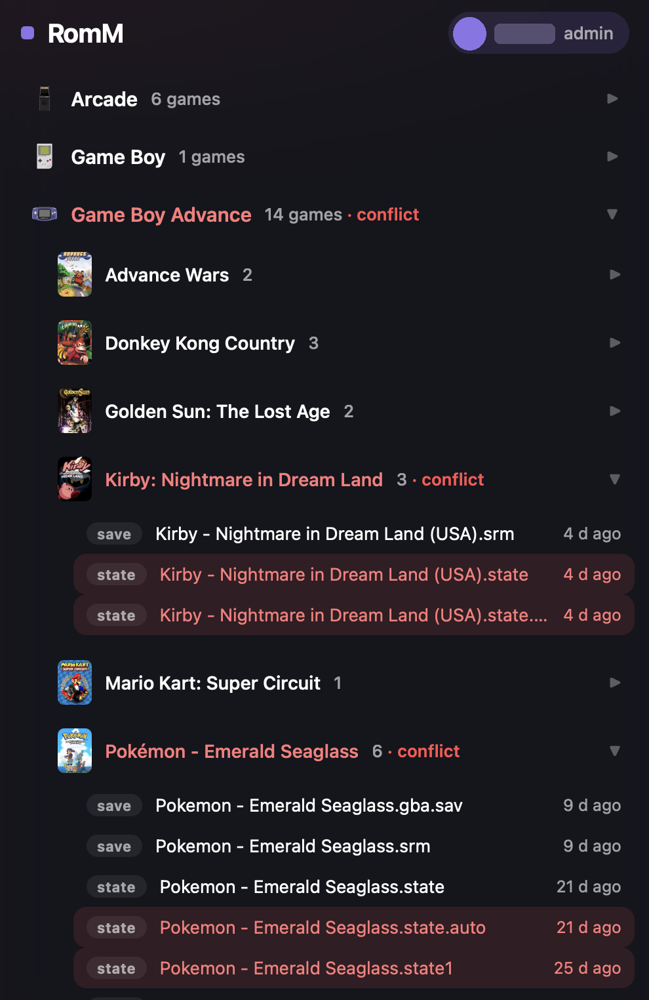

What RomM holds for the same games, grouped by game with cover art, and the RomM user the app is connected as in the top right. Here too, files with an open issue are shaded.

## 3. Resolving things

Click a card in "Needs you" to open that game's issues. Each file is shown side by side, the Syncthing copy and the RomM copy, with its modified time, size and the first characters of its md5. Pick **Keep Syncthing copy** or **Keep RomM copy**. The copy you did not keep is saved to the backup folder first, and the file then syncs normally. There are two cases, which differ in what the app knows.

### Changed on both sides (conflict)

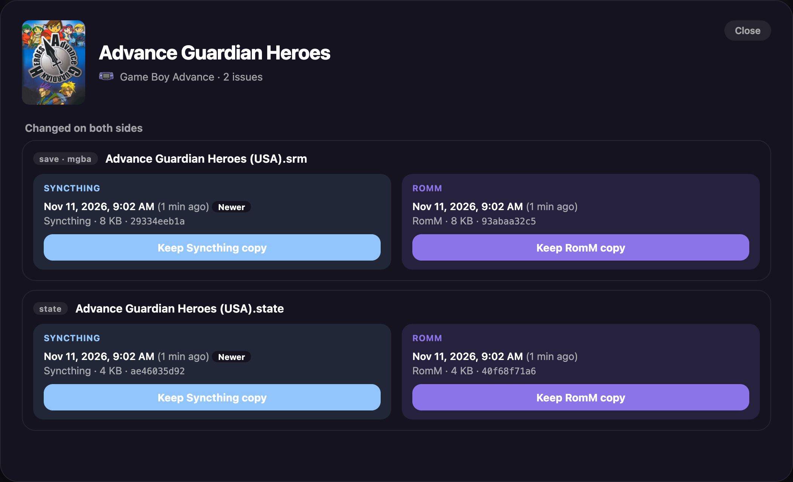

The app has synced this file before, and since then it changed in the sync folder and in RomM. The side with the later modified time is marked **Newer**, but that is only a hint: the file is held until you choose, and a clock that is behind can make the older copy look newer.

### Differs, no sync history

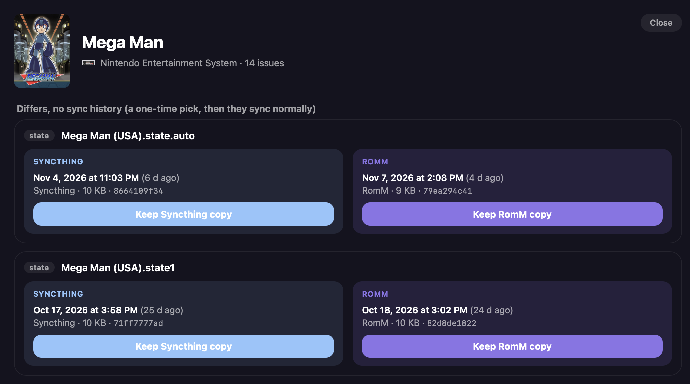

The app has never seen these two files agree, for example on a first run against a library that was already in RomM, so it cannot tell which side is right and will not guess. This is a one-time pick: after you choose, the file syncs normally. If the two sides turn out to have identical content, nothing is shown and the file is just recorded as in sync.

### Held RomM downloads

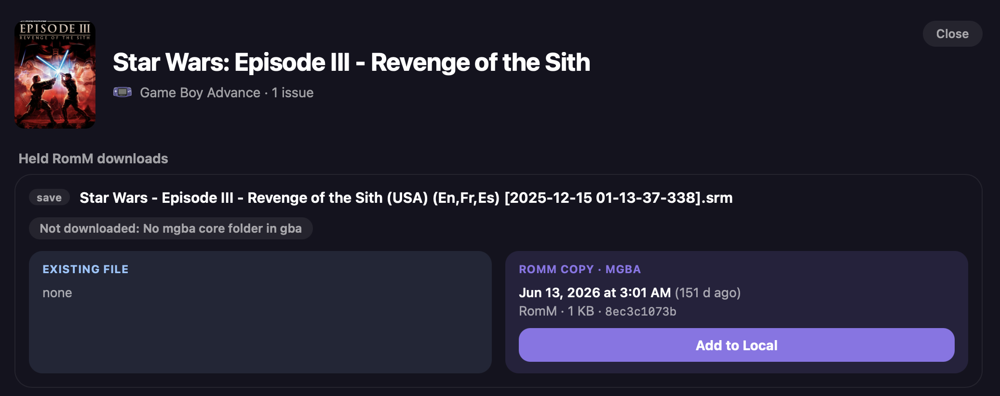

A save or state that exists only in RomM (for example from the web player) is downloaded automatically when its destination is free. When it cannot be placed, it is held with the reason, here *No mgba core folder in gba*: the file has an emulator, but there is no core folder for it. The other reason is that the path is taken by a different file. **Add to Local** opens a dialog:

- **Content Dir Only** puts the file in the platform folder.
- **Content Dir + Core** puts it in the emulator's core folder, creating the folder if needed (offered only for files that have an emulator).
- **Cancel** does nothing.

A choice is disabled when its destination already exists; nothing is ever overwritten.

### Syncthing conflict copies

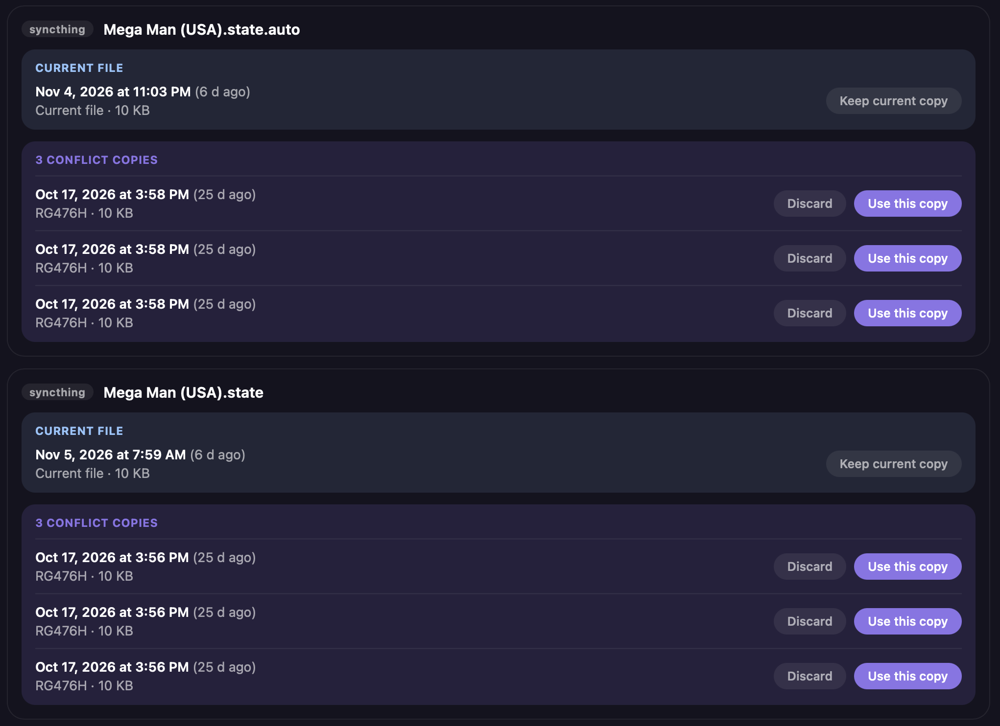

When Syncthing finds a file changed on two devices, it keeps the loser as `*.sync-conflict-*`. These are listed under the game, with the current file on top and the copies below. The device name comes from the ID in the copy's file name. Syncthing's copies are never synced to RomM.

- **Use this copy** replaces the current file with that copy. The current file is backed up.
- **Discard** removes that copy. It is backed up.
- **Keep current copy** keeps the current file and discards every copy listed for it.

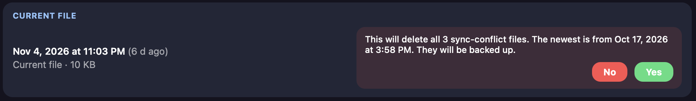

Keep current copy asks for confirmation first and says how many files will be removed and how old the newest one is. Everything removed is written to `DATA_DIR/backups`, outside the sync folders, so Syncthing does not spread it.

## 4. Push-only mode

When the sync folders are mounted read-only (or `PUSH_ONLY=true`), the app never writes to them.

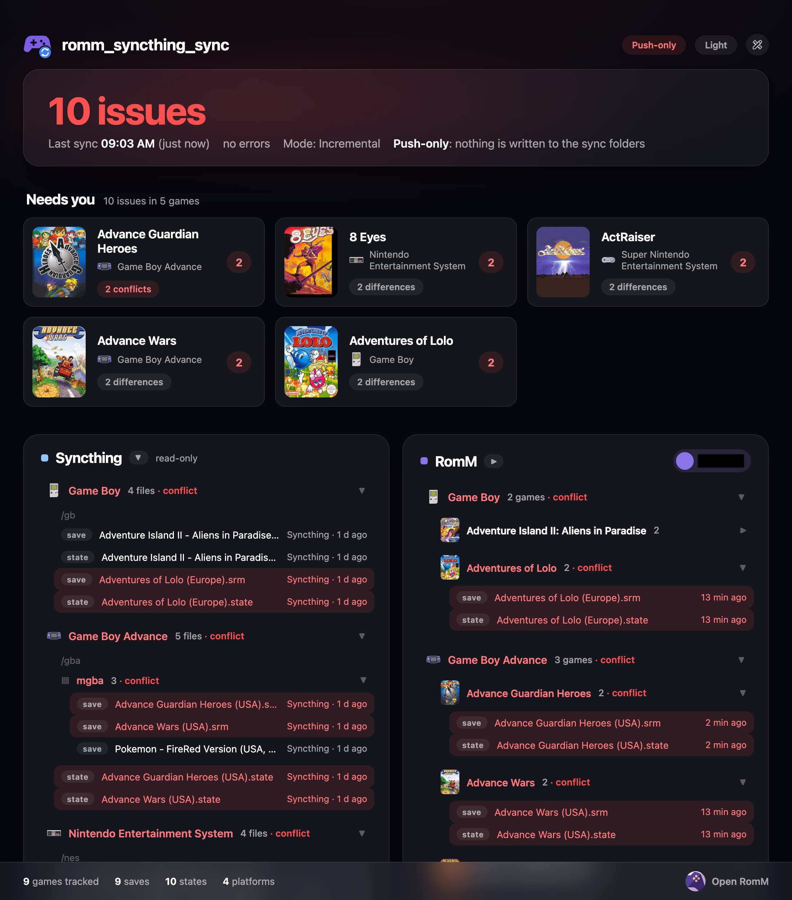

The page says so in three places: a **Push-only** chip in the top right, the line "Push-only: nothing is written to the sync folders" in the hero card, and a `read-only` badge on the Syncthing panel. The Needs-you cards and dashboards work as usual, but anything that would write to a sync folder is disabled.

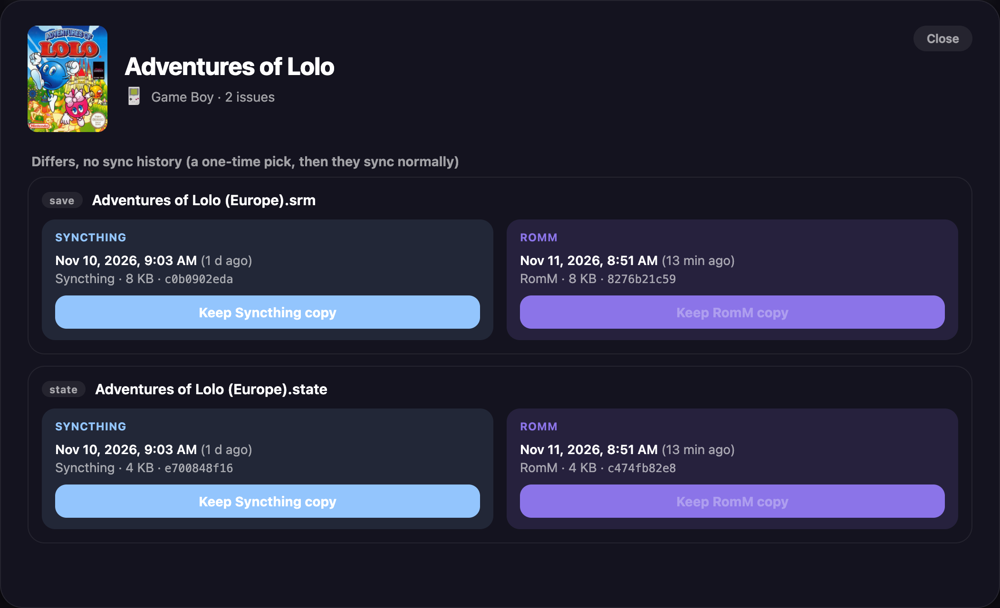

In a modal, **Keep RomM copy** is greyed out because it would overwrite the sync-folder file. **Keep Syncthing copy** still works, since it only uploads. Add to Local and the Syncthing conflict actions are disabled the same way.

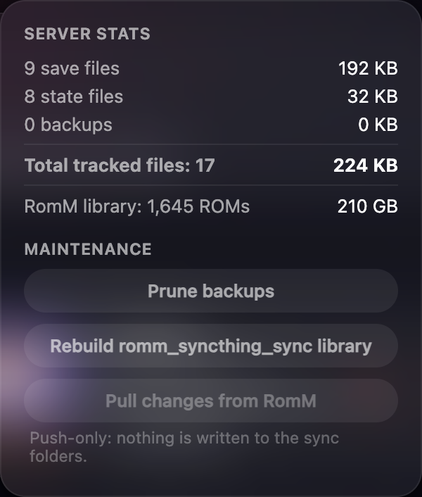

The actions menu (top right) shows the server totals and the maintenance actions. In push-only mode "Pull changes from RomM" is disabled and a note explains why. Unlike two-way mode, push-only still decides what to upload by modified time, so see [Sync strategy](SYNC_STRATEGY.md#push-only) before relying on it.

## 5. Also on the page

- **Unmatched games.** Below the dashboards and above the application log, a collapsed list of local games that match no RomM game, with a hint to check the platform mapping and the ROM's file name. It is informational: nothing is held or changed.
- **Application log.** The most recent log lines, collapsed by default.
- **Game history.** Click any file row to see every push, pull, match and resolution for that game, including failed transfers.
- **Notes under "Needs you".** Games whose history is orphaned (the ROM was removed or re-added in RomM) and files that exist both in a platform folder and a core folder (only the newest copy is synced).

Every action that writes shares one lock with the sync loop, so a click waits for a running sync to finish.
